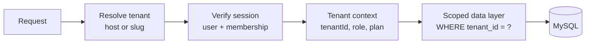

# Multi-Tenant Gurdwara Platform: Architecture and Rollout Plan

Status: proposal. Nothing in this document is implemented yet.
Goal: one codebase and deployment where each Gurdwara ("tenant") manages its own content, people, branding, integrations and donations, with no ability to see or change another Gurdwara's data.

## 1. Where the app stands today

Findings from the current code that shape the design:

| Area | Today | Impact on multi-tenancy |
|---|---|---|
| Branding | One record (`gurdwara_branding` singleton: name, logo, colors) | Must become per-tenant |
| Storage | Typed MySQL tables (`news_articles`, `schedule_entries`, `hukamnama_entries`, `donation_records`, ...) plus generic `app_items(resource, ...)` and `app_singletons(resource, payload)` | Every table and every `resource` key needs a tenant scope |
| Identity | Server reads `X-Actor-Role`, `X-Actor-Email`, `X-Actor-Name` request headers (`getRequestActor` in `server/index.js`) | **Blocker.** Headers are client-supplied, so a user could claim any role. Must be replaced by verified sessions before tenants exist |
| Roles | Global strings: `admin`, `super admin`, etc. (`canManageDonations`, `isSuperAdmin`) | Roles must be scoped per tenant, with a separate platform-level role |
| Integrations | Env vars: one Meta token, one Stripe key, one SMTP, one OpenWA group, one `PUBLIC_SITE_URL` | Per-tenant encrypted credentials |
| Uploads | One `uploads/` tree | Per-tenant prefix and quotas |
| Public site | One configured public domain per deployment | Needs domain/subdomain to tenant resolution |
| Schedulers | Global timers (reminders, social sweep) | Must iterate tenants with isolation |

## 2. Recommended model

**Shared database, shared schema, `tenant_id` on every row**, with tenant resolved on every request.

Why not the alternatives:

| Option | Pros | Cons | Verdict |
|---|---|---|---|
| Database per tenant | Strongest isolation | Migrations and ops multiply by N; hard on shared Hostinger hosting | Only for very large or regulated tenants later |
| Schema per tenant | Good isolation | MySQL schemas are databases; same ops cost | No |
| **Shared tables + `tenant_id`** | Simple ops, one migration, cheap to add a tenant | Needs strict, centrally enforced scoping | **Chosen** |

Isolation is enforced in three layers so one bug is not enough to leak data: request resolution, a tenant-scoped data-access layer, and database constraints (foreign keys and composite indexes starting with `tenant_id`).

## 3. Core concepts



### 3.1 Entities

```
tenants            id, slug, name, status, plan, created_at
tenant_domains     tenant_id, hostname (unique), is_primary, verified_at
tenant_settings    tenant_id, branding JSON, time_zone, locale, features JSON
tenant_secrets     tenant_id, key, ciphertext, key_version   (encrypted at rest)
users              id, email (unique), name, auth_provider
memberships        user_id, tenant_id, role, status           (unique user+tenant)
platform_admins    user_id                                    (SaaS operator only)
tenant_usage       tenant_id, month, storage_bytes, posts, emails, ai_calls
```

A person can belong to several Gurdwaras with a different role in each.

### 3.2 Roles

| Scope | Role | Can do |
|---|---|---|
| Platform | Platform admin | Create/suspend tenants, impersonate for support (audited), see usage and billing |
| Tenant | Owner | Everything in the tenant, billing, domains, delete tenant |
| Tenant | Admin | All content, people, donations, integrations |
| Tenant | Editor | News, events, gallery, hukamnama, schedule |
| Tenant | Granthi | Hukamnama, live recitation, Ask a Granthi |
| Tenant | Treasurer | Donations and reports, read-only elsewhere |
| Tenant | Volunteer lead | Seva, bookings, langar |
| Tenant | Viewer | Read-only admin |

Map the current `admin` / `super admin` strings onto these, then replace the `canManage*` helpers with a single `can(user, tenant, permission)` check driven by a role-to-permission table (`news.write`, `donations.read`, `social.post`, ...).

## 4. Tenant resolution

Resolve in this order and reject unknown hosts:

1. **Custom domain**: `tenant_domains.hostname` (for example `www.examplegurdwara.org`).
2. **Subdomain**: `{slug}.yourplatform.org`.
3. **Path or header for admin and local dev**: `/t/{slug}/...` or `X-Tenant` (only honored after the session proves membership).

The frontend reads tenant branding and feature flags from `GET /api/tenant/public` once at startup, replacing the current single-branding fetch.

Custom domains need: DNS verification record, automatic TLS (Hostinger or a proxy such as Cloudflare for SaaS), and a hostname-to-tenant cache with a short TTL.

## 5. Security prerequisites (do these first)

1. **Replace header-based identity with verified sessions.** Issue a signed, short-lived JWT or server session after Google sign-in; the server derives user, tenant and role from it. Never trust `X-Actor-*` headers from the browser. This is the single most important change and is worth doing even before multi-tenancy.
2. **Centralize data access.** Introduce a `tenantDb(ctx)` wrapper so handlers cannot run a query without a tenant. Direct use of `eventsDb` in handlers is banned in new code.
3. **Database constraints.** Add `tenant_id NOT NULL` plus composite unique keys such as `(tenant_id, slug)`. Foreign keys include `tenant_id` so a child row cannot point at another tenant's parent.
4. **Secrets.** Store per-tenant Meta, Stripe, SMTP and OpenWA credentials in `tenant_secrets`, encrypted with a master key kept in the server environment (envelope encryption, key versioning). Show only status and last four characters in the UI.
5. **Uploads.** Store under `uploads/{tenantId}/...`, validate path segments, enforce per-tenant quotas.
6. **Audit log.** Add `tenant_id` and `actor` to every audit record; platform-admin impersonation is always logged.
7. **Rate limits and quotas** per tenant, so one Gurdwara cannot exhaust shared capacity.
8. **Cross-tenant test suite.** Automated tests create two tenants and assert that every read, write, search, export and background job returns only its own data.

## 6. Data migration plan

Existing data becomes the first tenant with no behaviour change.

1. Create the new tables and insert the initial tenant with a deployment-specific slug.
2. Add `tenant_id` columns as nullable, backfill with tenant #1, then set `NOT NULL` and add indexes.
3. For `app_items` and `app_singletons`, change the key from `resource` to `(tenant_id, resource)`.
4. Move the current env-based credentials into `tenant_secrets` for tenant #1; keep env fallback for one release.
5. Run both code paths behind a feature flag, verify with the cross-tenant tests, then remove the single-tenant paths.

Rollback: the migration is additive; reverting the code and ignoring the new columns restores the old behaviour.

## 7. Per-tenant configuration surface

| Setting | Source today | Multi-tenant home |
|---|---|---|
| Name, logo, colors, fonts | `gurdwara_branding` singleton | `tenant_settings.branding` |
| Time zone, language defaults | Env | `tenant_settings` |
| Stripe / Zeffy / donation campaigns | Env | `tenant_secrets` and `donation_campaigns.tenant_id` |
| Meta (Facebook/Instagram/WhatsApp) | Env | `tenant_secrets`, plus a "Connect Meta" OAuth flow so each Gurdwara authorizes its own Page |
| Email sender and SMTP | Env | Shared platform sender with per-tenant reply-to, or tenant SMTP |
| Social posting toggles, LED screens, schedules | Singletons | Tenant-scoped singletons |
| Feature flags (library, kids learning, bookings, streaming) | None | `tenant_settings.features`, tied to `plan` |

Social posting becomes the first self-service integration: a **Connect Facebook/Instagram** button runs Meta OAuth, stores a long-lived token for that tenant, and the token-status check already added to the Social Posts page runs per tenant.

## 8. Onboarding a new Gurdwara

1. Platform admin (or a public sign-up form with approval) creates the tenant: name, slug, owner email, time zone.
2. Owner signs in, completes a checklist: branding, home page content, hukamnama source, donation account, social accounts, domain.
3. Template content is cloned from a starter tenant (pages, schedule skeleton, FAQ, kids learning, quizzes).
4. Platform sets plan and feature flags; usage meters start.

Offboarding: suspend, export all tenant data as a ZIP (JSON plus media), then scheduled hard delete.

## 9. Frontend changes

- `BrandingContext` becomes `TenantContext` (branding, features, locale, plan).
- Route guards check `feature.enabled` and the user's tenant permission, not just a role string.
- Admin shell shows a tenant switcher for users with several memberships.
- A separate `/platform` admin area (platform admins only): tenants list, usage, impersonation, announcements, template management.
- All client cache keys (React Query) include the tenant id so switching never shows stale data.

## 10. Background jobs and integrations

- Replace global timers with a job runner that loops active tenants, runs each job inside a tenant context, isolates failures, and records last-run per tenant.
- Webhooks (Stripe, Zeffy, Meta/WhatsApp) include the tenant in the path or are resolved from the account/phone-number id, then verified with that tenant's secret.
- Outbound sending (email, WhatsApp, social) applies per-tenant rate limits and logs.

## 11. Billing and plans (optional)

| Plan | Typical limits |
|---|---|
| Community (free) | 1 admin seat set, core pages, events, news, hukamnama, 2 GB media |
| Standard | Donations, bookings, newsletter, social posting, 20 GB |
| Premium | AI features, LED screens, custom domain, 100 GB, priority support |

Meter storage, emails, social posts and AI calls in `tenant_usage`. Stripe Billing or manual invoicing can follow later; start with limits only.

## 12. Phased rollout

| Phase | Scope | Exit criteria |
|---|---|---|
| 0. Hardening | Verified sessions, central permission check, audit actor, remove header trust | Penetration-style test that forged headers no longer work |
| 1. Foundations | `tenants`, `memberships`, tenant column on core tables, scoped data layer, tenant #1 backfill | All existing features work unchanged for tenant #1 |
| 2. Second tenant | Host resolution, per-tenant branding, secrets store, cross-tenant tests | Two tenants fully isolated in automated tests |
| 3. Self-service | Onboarding wizard, Connect Meta/Stripe, template cloning, platform admin | A new Gurdwara goes live without developer help |
| 4. Scale | Custom domains with TLS, quotas, usage dashboards, billing, exports | Operating five or more tenants with monitoring |

## 13. Risks and mitigations

| Risk | Mitigation |
|---|---|
| Data leak between tenants | Scoped data layer, composite keys, cross-tenant tests in CI |
| Forged roles (current header model) | Phase 0 before any second tenant |
| Hosting limits (shared Hostinger Node process) | Per-tenant quotas, caching, plan to move to a VPS/container host before many tenants |
| Token and secret handling | Envelope encryption, never returned to the browser, rotation UI |
| Migration mistakes | Additive migration, staging dry run, backups, feature flag |
| Content moderation and brand misuse | Platform terms, tenant suspension, audit trail |
| Meta app review for many Pages | Submit the app for Advanced Access and use OAuth per tenant |

## 14. Decisions needed from you

1. Will tenants be Gurdwaras you onboard personally (invite-only) or open sign-up?
2. Do you want custom domains in the first release, or subdomains only?
3. Free for sangat, paid plans, or donation-supported?
4. Who owns each tenant's data and donations (their own Stripe/Zeffy accounts)? Recommended: each Gurdwara connects its own.
5. Which existing features should be tenant-optional (library, kids learning, streaming, LED screens)?
6. Hosting target after Hostinger shared hosting (VPS, container platform)?

## 15. Rough work breakdown (for estimating)

- Auth and permissions refactor: sessions, `can()`, role mapping.
- Database migration and scoped data layer across about 30 tables and the generic stores.
- Tenant resolution middleware, domain table, TLS and DNS verification.
- Secrets store and per-tenant integration settings (Meta OAuth, Stripe, SMTP).
- Frontend `TenantContext`, switcher, feature flags, platform admin area.
- Job runner and webhook routing.
- Onboarding wizard, template cloning, data export.
- Test suite (isolation, permissions, migration) and operations runbook.
